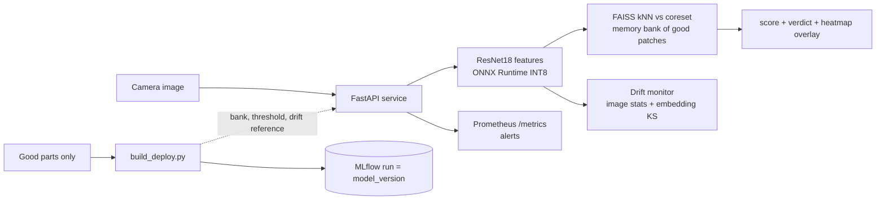
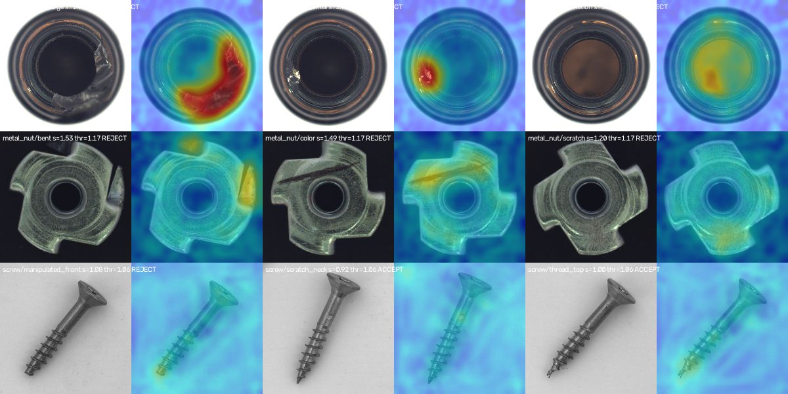
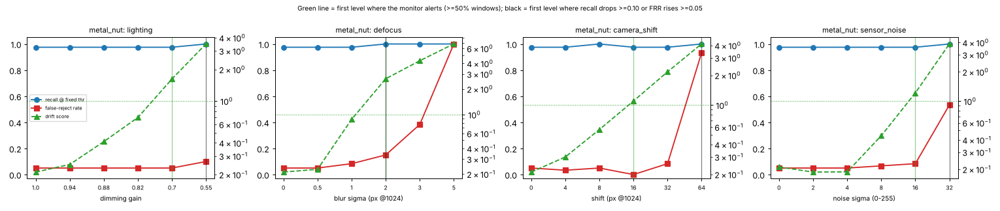

# edge-defect-inspection

**An inspection station that learns from good parts only**, runs on a CPU/edge box, shows operators a defect heatmap, and warns when the camera or lighting drifts. New production lines have no labelled defects yet, so supervised models are not an option on day one.
For: manufacturing/quality engineers evaluating anomaly detection against the rule-based vision they run today.

Results are in factory terms: defect recall at a fixed false-reject rate, parts/s per CPU, cost per 1,000 parts. Data: MVTec AD `bottle`, `metal_nut`, `screw` only (CC BY-NC-SA 4.0, non-commercial; see `docs/DATA.md`).



## Results (3 MVTec categories, 4-vCPU Xeon VM, batch 1, 1 seed)
| method | mean image AUROC | bottle / metal_nut / screw | pixel AUROC / PRO | latency p50 / p99 |
|---|---|---|---|---|
| Classical golden-image rules (Phase 1) | 0.716 | 0.985 / 0.637 / 0.526 | n/a | 1.2 / 1.3 ms |
| PatchCore ResNet18, PyTorch FP32, 10% coreset | 0.972 | 1.000 / 0.992 / 0.923 | 0.983 / 0.932 | 34 / 54 ms |
| **PatchCore ONNX Runtime INT8, 5% coreset (deployed)** | 0.968 | 1.000 / 0.992 / 0.912 | 0.983 / n/a | 25 / 37 ms (4 threads); 50 ms (1 thread) |

Factory view: at a threshold set from good parts only, for the deployed model recall is 1.00 (bottle), 0.98 (metal_nut) and 0.45 (screw); false-reject rate on test goods 0% / 9% / 2%. Throughput ~40 parts/s on 4 threads, ~$0.001 per 1,000 parts at an *assumed* $0.04/vCPU-hour. Details: `results/RESUME_METRICS.md`.


*Defect, operator overlay for bottle, metal_nut, screw. Screw defects are mostly missed or only weakly highlighted: this is the model's honest limit.*

Drift (synthetic lighting / blur / shift / noise, 6 severities): the monitor never false-alarmed on clean parts and alerted before operational degradation in 7 of 8 curves (tie in 1). Under drift, recall did not fall; **good parts get scrapped** (false-reject rate up to 100%).

*Green = drift score (alert at 1.0), red = false-reject rate, blue = recall; vertical lines mark first alert (green) and first degradation (black). Bottle plot: `results/plots/drift_bottle.png`.*

## Key decisions (all with numbers in `docs/DECISIONS.md`)
- **ADR-001** Classical alignment hurt (screw AUROC 0.10 with moment-based rotation) -> dropped.
- **ADR-002/003** PatchCore: coreset keeps accuracy at 6.5x lower latency and 10x less memory; WideResNet50 and alignment did not help.
- **ADR-004** INT8 PTQ: model 11.0 -> 3.1 MB for -0.002 AUROC; the speed-up is modest because kNN search is not quantised. Found and fixed an ONNX export bug and a 2x thread-contention slowdown.
- **ADR-005/006** Service + MLflow traceability; drift monitor design, thresholds and how they were set.

## Quickstart
```bash
make setup download test            # CPU torch, 3 MVTec categories (~480 MB), tests
make bench-classical bench-patchcore bench-edge   # reproduce the tables
make build-deploy serve             # ONNX export + INT8, MLflow-tracked artifacts, then the API on :8000
curl -F image=@data/mvtec_ad/bottle/test/broken_large/000.png localhost:8000/inspect/bottle
make bench-drift                    # drift experiment and plots
```
Settings live in `config.yaml`. Methodology: `docs/BENCHMARKS.md`; environment: `docs/ENVIRONMENT.md`.

## Limitations (read these)
- Only 3 categories, one seed, 100 good training images per category; differences below ~0.01 AUROC are noise.
- Thresholds come from only 40 good validation parts, so test false-reject rate is noisy (metal_nut 9% vs 1% target).
- Screw (small defects, random rotation) is not solved: recall 0.35-0.45.
- "Edge" numbers are thread-limited emulation on a cloud VM, **not real Jetson/Raspberry Pi hardware**. GPU/TensorRT and the supervised-vs-anomaly study: notebooks in `notebooks/` are written but **not executed here** (no GPU), so no results are claimed.
- Docker image, docker-compose and Prometheus rules: **not verified in this environment** (no Docker daemon); only config syntax was validated.
- Drift tested on synthetic perturbations only; its thresholds were tuned once on the same data (ADR-006).
